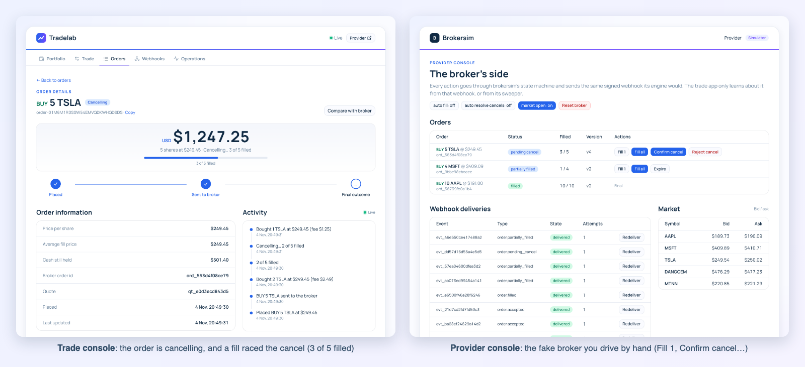
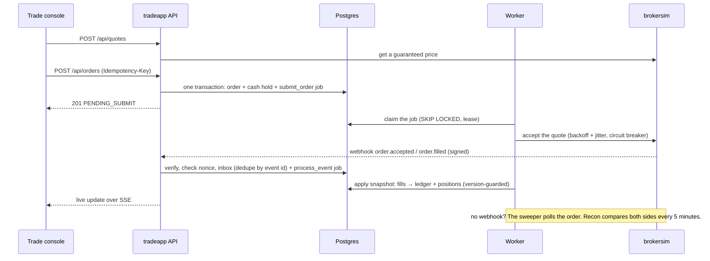
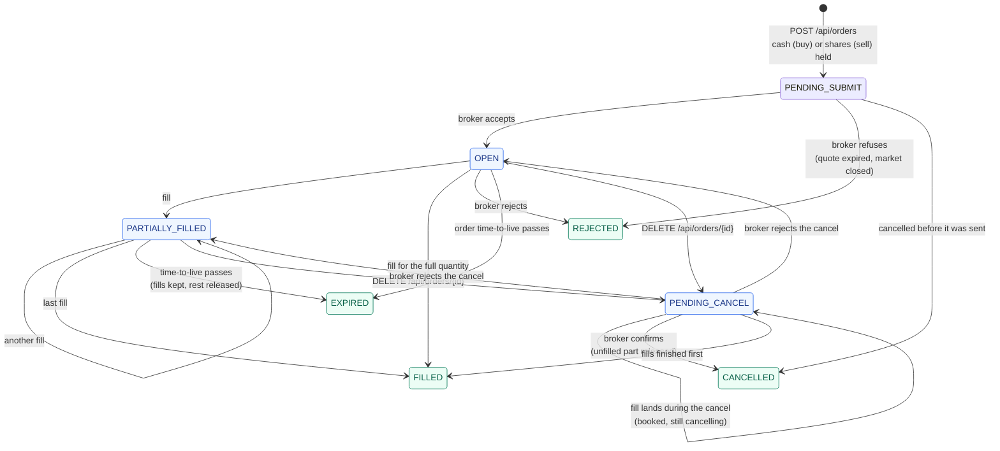

# Tradelab

**A small brokerage and a fake broker, built for the failure cases: idempotent retries, a double-entry ledger, signed webhooks, an outbox with a dead-letter queue, and reconciliation.**

**tradeapp** lets a user fund an account, get a guaranteed quote, place and cancel orders, and watch fills arrive live. It trades against **brokersim**, a fake stock broker that behaves like a real third party: it accepts orders asynchronously, fills them in pieces, sends signed webhooks (sometimes late, twice, or never) and occasionally refuses. The interesting part is everything around the happy path.



- **Backend:** Go, Postgres, raw SQL with pgx (the only other Go dependency is a ULID library).
- **Frontend:** Svelte 5, shadcn-svelte, Tailwind.

## Running it

Needs only Docker:

```bash
make docker
```

| What | Where |
| --- | --- |
| Trade console | http://localhost:8088 |
| Provider console (the fake broker) | http://localhost:8088/#/provider |

**Try this (2 minutes).** The broker is manual, so you play both sides:

1. *Portfolio* → **Fund account** → $10,000.
2. *Trade* → buy 5 TSLA → **Get quote** → **Confirm**.
3. In the provider console, press **Fill 1** twice and watch the order fill live in the trade console.
4. Back in the trade console, open the order and press **Cancel order**. It shows *Cancelling*.
5. In the provider console, press **Fill 1** again (a fill racing the cancel), then **Confirm cancel**. The order ends *Cancelled* with "3 of 5 bought, 2 cancelled": the three shares are in your portfolio and the hold for the other two is released.

The full tour, including forged webhooks, retries that can't charge twice and reconciliation, is [`docs/DEMO.md`](docs/DEMO.md) (7 minutes).

**Other ways to run it:**
- `make docker-obs`: the same, plus logs, metrics and alerts ([`docs/OBSERVABILITY.md`](docs/OBSERVABILITY.md)).
- `make docker-down` stops it and keeps the data; `make docker-clean` also deletes the data.
- `SIM_AUTO=true make docker`: the broker fills orders by itself.
- **Natively:** with Go, Node.js and Postgres on `localhost:5432`, run `make up`. The web app is then at http://localhost:5173, it starts from an empty database each time (`KEEP_DATA=1` keeps it), and `AUTO=1` makes the broker fill orders by itself.
- If a port clashes with something on your machine, move it with `WEB_PORT`, `API_PORT`, ….

## Hard problems and how they're handled

| Problem | Approach | Where |
| --- | --- | --- |
| A retried request charging twice | An `Idempotency-Key` on money-moving routes. Records go STARTED → COMPLETED or FAILED: 4xx responses are replayed, 5xx releases the key, crashed requests are reaped. The browser keeps each key in `sessionStorage` until it gets a definite answer, and retries timeouts with the same key. | `service/idempotency.go`, `web/src/lib/intent.js` |
| Money that doesn't add up | A double-entry ledger with cash holds. Eight invariants (entries balance, holds match open orders, no negative balances…) are asserted after every test that moves money, and checked live. | `service/ledger.go`, `repository/invariants.go` |
| Webhooks lost, duplicated or out of order | An inbox deduplicated by event id, snapshots guarded by the provider's version, fills deduplicated by fill id, and a sweeper that polls orders that went quiet. | `service/events.go`, `service/snapshot.go`, `service/sweeper.go` |
| Forged or replayed webhooks | HMAC-SHA512 over `timestamp.nonce.body` (constant-time compare), a ±5 minute window, and a nonce cache: a repeat gets 409 `replay_detected`. | `transport/http/webhook.go` |
| The broker being down | Outbox jobs with exponential backoff and full jitter, a retry budget, then a dead-letter queue with one-click or bulk replay. A circuit breaker stops calls to a failing broker. | `service/jobs.go`, `provider/breaker.go` |
| The two systems drifting apart | Reconciliation every 5 minutes and on demand, plus a per-order comparison. Anything that doesn't fit is recorded as a break, never silently fixed. | `service/recon.go` |
| Abuse | A per-user token bucket per route group: 429 with `Retry-After`. | `transport/http/ratelimit.go` |
| Following one request | `X-Request-Id` goes into every log line and onto the jobs a request queues. Prometheus metrics, 9 alert rules. | `internal/reqid`, `internal/metrics` |

## Decision log

The calls that shape the system. The full reasoning, with the alternatives considered, is in [`tradeapp/DECISIONS.md`](tradeapp/DECISIONS.md).

- **The first final state wins.** Once an order is FILLED, CANCELLED, REJECTED or EXPIRED, nothing changes it. A late webhook, a replayed snapshot or a sweeper poll can't reopen it; a contradiction is recorded as a break for a human.
- **A fill is a fact.** The broker says shares changed hands, so a fill is always booked, even one that arrives after the order looked final or one the hold can't cover. The contradiction goes to `breaks`. Refusing the fill would make our books lie about what the broker did.
- **Our order id is the broker's `client_order_id`.** Submitting is retried by a background job. If the first attempt reached the broker but its answer was lost, the retry sends the same id, and the broker returns the existing order instead of creating a second one. Reconciliation matches the two systems on the same id.
- **4xx responses are replayed, 5xx responses release the idempotency key.** A rejection like *insufficient funds* is an answer: a retry with the same key gets the same answer, never a fresh attempt that might now succeed and surprise the user. A 5xx means the transaction rolled back and nothing happened, so the browser's automatic retry runs it again instead of waiting out a zombie timeout.
- **Nobody waits on the broker to place an order.** The order, its cash hold and the outbox job are one transaction. The user gets an instant answer, and a broker outage only delays submission.
- **Money is integer cents everywhere.** No floats in Go, SQL or JavaScript. Average cost rounds down; fees are their own ledger entries.

## Architecture


### How an order flows



### Order lifecycle

Every order moves through this state machine (`domain.NextStatus`). The broker's webhooks and polled snapshots propose a status, and the rules decide whether to take it.



Blue states are working at the broker; green states are final.

The rules behind the arrows:
- **Older news never rewinds an order.** Every update carries the broker's version, and an update older than the one already applied is ignored.
- **A cancel is a request, not a fact.** While cancelling, a snapshot that still says OPEN or PARTIALLY_FILLED means a fill arrived first. The order stays PENDING_CANCEL unless the broker rejected the cancel.
- **Money moves only on fills and final states.** Each fill pays from the hold. Reaching a final state releases whatever is still held.

### Where the numbers come from

The fee is 0.5% of each fill's value (brokersim's `SIM_FEE_BPS=50`).

| Number | How it's computed |
| --- | --- |
| Available cash | The cash ledger account: funding − buys (price × qty + fee) + sells (price × qty − fee) − held |
| Held for orders | What open BUY orders have reserved: the quote total, minus what fills have already paid |
| Average cost | The weighted average price paid per share: `(qty × avg + bought × price) ÷ (qty + bought)` |
| Positions value | `qty × current bid` per position: what you'd get selling now, before the sell fee |
| Unrealized P&L | `(bid − avg cost) × qty`: the gain or loss on paper |
| Realized P&L | Added on each sell: `(sell price − avg cost) × qty − sell fee` |

**Why average cost leaves fees out:** it then means exactly "the average price you paid per share", the same figure as the fill prices the broker reports, and fees stay visible as their own ledger entries instead of disappearing into a price. The trade-off is that buy fees don't show up in P&L (see [Known limitations](#known-limitations)).

### Layers

| Layer | Package | Rule |
| --- | --- | --- |
| Wiring | `internal/sys` | `NewDependencies` opens the database, builds the repository, the provider client and every service. `main` starts the API and the worker from it. |
| Transport | `internal/transport/http` | HTTP only: decode, call a service, encode. Middleware for request ids, metrics, panics, rate limits and the Idempotency-Key protocol. Never touches the repository. |
| Driver | `internal/worker` | Loops and calls the service: outbox jobs, stuck-order sweeper, reconciliation, cleanup. |
| Service | `internal/service` | All rules, validation, ids and orchestration, each operation in `repo.RunInTx`. |
| Repository | `internal/repository` | Dumb: one SQL statement per method, explicit columns, takes a `pgx.Tx`. Writes return only `error`. |
| Domain | `internal/domain` | Models and pure rules (order state machine, money, alerts). |

## Tests, and what they prove

```bash
make check         # every test plus the end-to-end run: about 50 seconds
make e2e-dropped   # end to end with every webhook lost: about 25 seconds
```

- **181 Go tests against a real Postgres** (no mocks), with the race detector. They include:
  - 20 concurrent requests with one idempotency key: exactly one funds the account;
  - a fill arriving after a cancel was requested;
  - an older snapshot arriving after a newer one (it never rewinds the order);
  - the broker down until the circuit opens, then recovery;
  - jobs exhausting their retry budget into the dead-letter queue, then bulk replay;
  - reconciliation finding dropped fills and orders on only one side.
- **`make e2e` runs the real binaries:** brokersim with auto-fill and signed webhooks, and the trade API.
  - **What it does:** funds $100,000, places six buys (one of them cancelled mid-flight), waits until every order is final, sells, then checks the books.
  - **It fails unless:** all eight invariants hold, there are zero breaks, zero dead jobs and no cash left held, reconciliation agrees with the broker across at least 7 orders, the cancelled order matches the broker's view, and the API logged no errors.
- **`make e2e-dropped` runs the same scenario with every webhook thrown away.** The sweeper has to discover every outcome by polling, and the same checks must pass.

## Observability

With `make docker-obs`:
- **Vector** ships every container's JSON logs to **VictoriaLogs**.
- **VictoriaMetrics** scrapes the API's Prometheus metrics, and **vmalert** evaluates 9 alert rules: the API down, dead-lettered jobs, a broken invariant, queue lag, the circuit open, the 5xx rate, refused webhooks, reconciliation mismatches, and reconciliation not running.

One request id follows an order from nginx through the API to the worker that submits it seconds later. Search `request_id:="…"` in VictoriaLogs to see all of it.

Details, the metric list and the alert table are in [`docs/OBSERVABILITY.md`](docs/OBSERVABILITY.md).

## Scope

### Assumptions

- **One user, no authentication.** Every request acts as the demo user. The request's actor comes from middleware (`withActor`), so adding auth means replacing one function, not touching the services.
- **One currency.** All amounts are USD cents. The Nigerian symbols (DANGCEM, MTNN) are priced in dollars too.
- **Quote-then-order only.** Every order executes at a price guaranteed by a quote; there are no limit or stop orders.
- **brokersim is the only broker,** and it runs in memory.

### Deliberately left out

KYC and onboarding, withdrawals and payouts, FX, margin and short selling (a sell needs shares you hold), corporate actions, a treasury or float account, and a real broker integration.

### Known limitations

- **brokersim forgets everything when it restarts.** The trade app's old open orders then show up as `missing_at_provider` in reconciliation, which is correct behaviour, but it means the two only stay in sync while brokersim keeps running.
- **Live updates poll Postgres.** Each open SSE stream checks for new rows every 500 ms. That's correct across several API instances, but costly with many viewers.
- **The rate limiter and the price cache are in memory,** so limits apply per API instance.
- **Buy fees don't show up in P&L.** They're booked in the ledger, but average cost excludes them and realized P&L subtracts only the sell fee. Unrealized P&L is therefore slightly optimistic.
- **Alerts aren't delivered.** They're evaluated and visible in vmalert, but there's no Alertmanager.
- **No CI yet.** The suite runs locally with `make check`.

### What I'd do next

1. **Auth and tenancy:** real users and a token in `withActor`. Lists are already filtered by `user_id`; single-order lookups by id would need the user added too.
2. **`LISTEN/NOTIFY` for live updates:** one listener per instance fans out to its SSE clients, instead of one poll per client.
3. **CI:** GitHub Actions running `make check` against a Postgres service container.
4. **A contract test against a real broker's sandbox,** so brokersim's behaviour is checked against reality, not only against itself.
5. **Load test at "market open":** a burst of quotes and orders with webhooks arriving out of order, to find the queue's and the ledger's limits.
6. **Alertmanager** routing critical alerts to a pager, and **fees in the cost basis** as a P&L option.

## Layout

```
brokersim/          the fake broker: REST API, engine, signed webhooks, dev API
tradeapp/
  cmd/api/          main: config → sys.NewDependencies → worker + API
  internal/         sys, transport/http, worker, service, repository, domain, provider, db (migrations), metrics, reqid
web/                one Svelte app for both consoles (trade and provider)
deploy/             Vector config, VictoriaMetrics scrape config, alert rules
docs/               DEMO.md (guided tour), OBSERVABILITY.md
scripts/            make up / make down, demo helpers
docker-compose.yml
```

Run `make` for every target.
