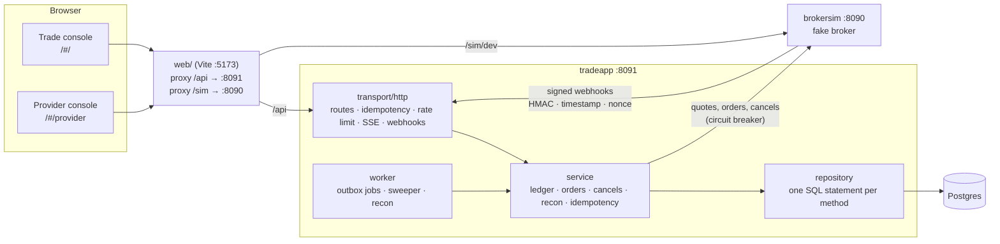
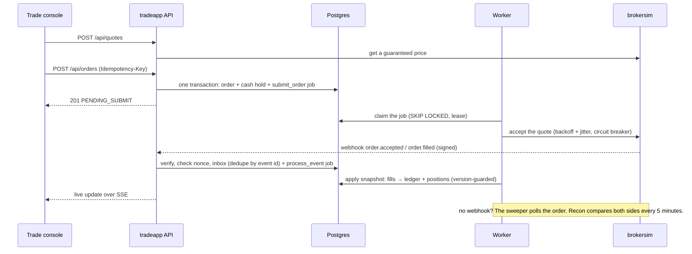
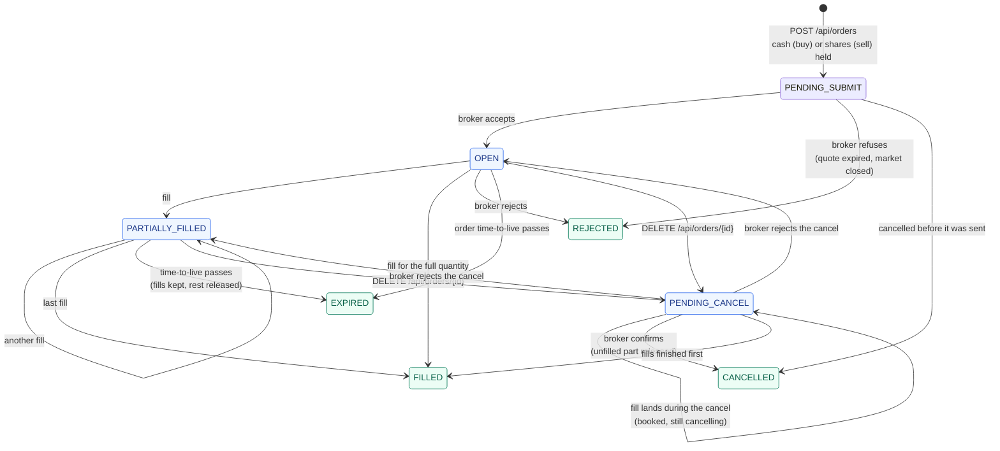
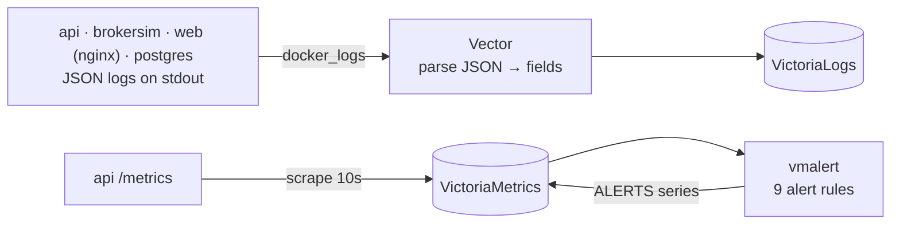

# vfs: a trading lab

A small brokerage built the way money-moving systems need to be built. **tradeapp** lets a user fund an account, get a guaranteed quote, place and cancel orders, and watch fills arrive live. It trades against **brokersim**, a fake stock broker that behaves like a real third party: it accepts orders asynchronously, fills them in pieces, sends signed webhooks (sometimes late, twice, or never) and occasionally refuses.

The interesting part is everything around the happy path: retries that can't charge twice, a ledger that always balances, webhooks that can't be forged or replayed, an outbox that survives a broker outage, and reconciliation that catches what slipped through anyway.

- **Backend:** Go, Postgres, raw SQL with pgx. The only other Go dependency is a ULID library.
- **Frontend:** Svelte 5, shadcn-svelte, Tailwind and Sonner.

## Architecture



**How an order flows.** Nothing calls the broker while the user waits for the order to be placed. The order, its cash hold and an outbox job are written in one transaction, so either all three exist or none do.



### Order lifecycle

Every order moves through this state machine (`domain.NextStatus`). The broker's webhooks and polled snapshots propose a status, and the rules decide whether to take it.



Blue states are working at the broker. Green states are final.

The rules behind the arrows:
- **The first final state wins.** Once an order is FILLED, CANCELLED, REJECTED or EXPIRED, nothing changes it. A late or replayed event is recorded as a break for a human, never applied.
- **Older news never rewinds an order.** Every update carries the broker's version, and an update older than the one already applied is ignored.
- **A cancel is a request, not a fact.** While cancelling, a snapshot that still says OPEN or PARTIALLY_FILLED means a fill arrived first. The order stays PENDING_CANCEL unless the broker rejected the cancel.
- **Money moves only on fills and final states.** Each fill pays from the hold. Reaching a final state releases whatever is still held.

### Where the numbers come from

All money is integer cents; there's no floating point anywhere. The fee is 0.5% of each fill's value (brokersim's `SIM_FEE_BPS=50`).

| Number | How it's computed |
| --- | --- |
| Available cash | Your cash ledger account: funding − buys (price × qty + fee) + sells (price × qty − fee) − held |
| Held for orders | What open BUY orders have reserved: the quote total, minus what fills have already paid |
| Average cost | The weighted average purchase price per share: `(qty × avg + bought × price) ÷ (qty + bought)`. Fees aren't included. |
| Positions value | `qty × current bid` per position: what you'd get selling now, before the sell fee |
| Unrealized P&L | `(bid − avg cost) × qty`: the gain or loss on paper |
| Realized P&L | Added on each sell: `(sell price − avg cost) × qty − sell fee` |

### Layers

| Layer | Package | Rule |
| --- | --- | --- |
| Wiring | `internal/sys` | `NewDependencies` opens the database, builds the repository, the provider client and every service. `main` starts the API and the worker from it. |
| Transport | `internal/transport/http` | HTTP only: decode, call a service, encode. Middleware for request ids, metrics, panics, rate limits and the Idempotency-Key protocol. Never touches the repository. |
| Driver | `internal/worker` | Loops and calls the service: outbox jobs, stuck-order sweeper, reconciliation, cleanup. |
| Service | `internal/service` | All rules, validation, ids and orchestration, each operation in `repo.RunInTx`. |
| Repository | `internal/repository` | Dumb: one SQL statement per method, explicit columns, takes a `pgx.Tx`. Writes return only `error`. |
| Domain | `internal/domain` | Models and pure rules (order state machine, money, alerts). |

## What it gets right, and where to look

| Problem | Approach | Where |
| --- | --- | --- |
| A retried request charging twice | An `Idempotency-Key` on money-moving routes. Records go STARTED → COMPLETED or FAILED: 4xx responses are replayed, 5xx releases the key, crashed requests are reaped. The browser keeps each key in `sessionStorage` until it gets a definite answer, and retries timeouts with the same key. | `service/idempotency.go`, `web/src/lib/intent.js` |
| Money that doesn't add up | A double-entry ledger with cash holds. Eight invariants (entries balance, holds match open orders, no negative balances…) are asserted after every test that moves money, and checked live at `/api/admin/invariants`. | `service/ledger.go`, `repository/invariants.go` |
| Webhooks lost, duplicated or out of order | An inbox deduplicated by event id, snapshots guarded by the provider's version, fills deduplicated by fill id, and a sweeper that polls orders that went quiet. | `service/events.go`, `service/snapshot.go`, `service/sweeper.go` |
| Forged or replayed webhooks | HMAC-SHA512 over `timestamp.nonce.body` (constant-time compare), a ±5 minute window, and a nonce cache: a repeat gets 409 `replay_detected`. Every request is logged for the inspector. | `transport/http/webhook.go`, `provider/webhook.go` |
| The broker being down | Outbox jobs with exponential backoff and full jitter, a retry budget, then a dead-letter queue with one-click or bulk replay. A circuit breaker stops calls to a failing broker. | `service/jobs.go`, `provider/breaker.go` |
| The two systems drifting apart | Reconciliation every 5 minutes and on demand, plus a per-order comparison. Anything that doesn't fit is recorded as a break, never silently fixed. | `service/recon.go` |
| Abuse | A per-user token bucket per route group: 429 with `Retry-After`. | `transport/http/ratelimit.go` |
| Following one request | `X-Request-Id` goes into every log line and onto the jobs a request queues, so the worker's logs carry it too. `/metrics` is Prometheus format. | `internal/reqid`, `internal/metrics` |

The reasoning behind each choice, with the alternatives considered, is in [`tradeapp/DECISIONS.md`](tradeapp/DECISIONS.md) and [`brokersim/DECISIONS.md`](brokersim/DECISIONS.md).

## Run it with Docker (nothing else to install)

```bash
make docker        # Postgres, brokersim, the API and the web app
make docker-obs    # the same, plus logs, metrics and alerts
make docker-down   # stop (data kept); make docker-clean also deletes it
```

| What | Where |
| --- | --- |
| Trade console | http://localhost:8088 |
| Provider console | http://localhost:8088/#/provider |
| Trade API | http://localhost:8091 |
| Logs: VictoriaLogs UI (with `docker-obs`) | http://localhost:9428/select/vmui |
| Metrics: VictoriaMetrics UI | http://localhost:8428/vmui |
| Alerts: vmalert | http://localhost:8880 |

The images are multi-stage builds. The Go services are static binaries on distroless, running as non-root, and check their own health (`api healthcheck`). The web app is built with Vite and served by nginx, which also proxies `/api` (with SSE buffering off) and `/sim`, so it's one origin just as in development. Every host port can be moved with an environment variable (`WEB_PORT`, `API_PORT`, …) if it clashes with something on your machine. `SIM_AUTO=true make docker` makes the broker fill orders by itself.

## Run it natively

Needs Go, Node.js, and Postgres on `localhost:5432` (no password).

```bash
make up      # builds and starts everything; Ctrl-C stops it all
```

| What | Where |
| --- | --- |
| Trade console | http://localhost:5173 |
| Provider console (brokersim) | http://localhost:5173/#/provider |
| Trade API | http://localhost:8091 |
| Metrics (Prometheus) | http://localhost:8091/metrics |

**The broker is manual by default.** Place an order in the trade console, then open the provider console and press *Fill 1*, *Fill all*, *Reject*, *Expire*, or *Confirm cancel* / *Reject cancel*, and watch the trade console update live. `AUTO=1 make up` lets brokersim's engine fill orders and resolve cancels by itself.

`make up` starts from an empty `tradeapp` database every time. brokersim keeps its state in memory and forgets it when it stops, so old orders would only show up as reconciliation mismatches. Use `KEEP_DATA=1 make up` to keep the data anyway.

**A guided tour:** [`docs/DEMO.md`](docs/DEMO.md) is a 7-minute walkthrough that shows each of the points above working.

## Observability



With `make docker-obs`, everything below is collected and stored, and the alert rules run. Each store has its own web UI (no dashboard server to maintain):
- **Logs:** the VictoriaLogs UI. Search `request_id:="…"` to see one request's lines from nginx, the API and the worker side by side, or `level:in("WARN","ERROR")` for problems.
- **Metrics:** the VictoriaMetrics UI. Query and graph anything, e.g. `sum by (route) (rate(http_requests_total[1m]))`.
- **Alerts:** the vmalert UI shows each rule as inactive, pending or firing, with its last value.

- **Logs:** structured (`log/slog`). Every line written while handling a request carries its `request_id` (sent as `X-Request-Id`, or generated). Jobs store the id of the request that queued them, so one id covers the whole order:
  ```
  msg="order placed"   order_id=order-01M6… request_id=demo-trace-42
  msg=http             path=/api/orders status=201 request_id=demo-trace-42
  msg="order submitted" provider_order_id=ord_ae8f… request_id=demo-trace-42   ← worker, later
  msg="job done"       kind=submit_order request_id=demo-trace-42
  ```
- **Metrics** (`GET /metrics`):
  - `http_requests_total` and `http_request_duration_seconds`, labelled by route pattern;
  - `webhooks_received_total` by outcome, `rate_limited_total`, `idempotency_requests_total` (new, replayed, conflict, in_progress), `jobs_processed_total`;
  - gauges read at scrape time: `jobs` by status, `jobs_dead`, `jobs_oldest_waiting_seconds`, `provider_circuit_state`.
  - gauges from the latest reconciliation run: `recon_mismatches`, `recon_invariants_ok`, `recon_open_breaks`, `recon_last_run_timestamp_seconds`.
- **Alerts** (`deploy/vmalert/alerts.yml`), each with what it means and where to look first:
  - critical: the API is down, a job was dead-lettered, a ledger invariant is broken;
  - warning: queue lag, the circuit open, a 5xx rate over 5%, a burst of refused webhooks, reconciliation mismatches, reconciliation not running.
- **In the console:** *Operations* shows system health, the dead-letter queue, reconciliation, the books check and breaks. *Webhooks* is a live terminal of every webhook request, with an inspector.

## Tests

```bash
make          # list targets
make test     # all Go tests (race detector, real Postgres) and the web build
make e2e      # end to end: the real binaries, every webhook delivered, reconciliation must come back clean
make e2e-dropped  # the same with every webhook lost: the sweeper must recover every order
make check    # test + e2e
make down     # stop a `make up` running elsewhere
```

The tests run against Postgres, not mocks. They include concurrency (20 requests with the same idempotency key fund once), lifecycle races (a fill arriving after a cancel), outages (the broker down until the circuit opens, then recovery), and the snapshot rules (an older snapshot never rewinds an order).

## Layout

```
brokersim/     the fake broker (provider): REST API, engine, signed webhooks, dev API
tradeapp/
  cmd/api/     main: config → sys.NewDependencies → worker + API
  internal/    sys, transport/http, worker, service, repository, domain, provider, db (migrations), metrics, reqid
web/           one Svelte app for both consoles (trade and provider)
scripts/       make up / make down, demo helpers
deploy/        Vector config, VictoriaMetrics scrape config, alert rules
docker-compose.yml
```
