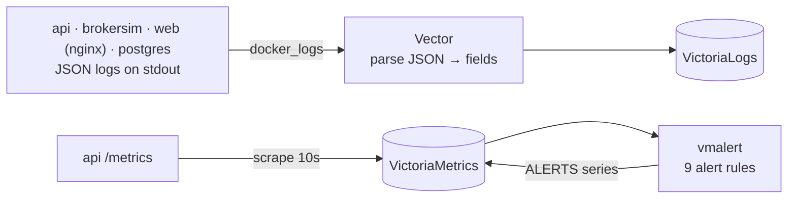

# Observability

How to see what tradeapp is doing: request ids in every log line, Prometheus metrics, alert rules, and an optional stack that stores and searches all of it.

```bash
make docker-obs   # the app plus Vector, VictoriaLogs, VictoriaMetrics and vmalert
```

| What | Where |
| --- | --- |
| Logs (VictoriaLogs UI) | http://localhost:9428/select/vmui |
| Metrics (VictoriaMetrics UI) | http://localhost:8428/vmui |
| Alerts (vmalert) | http://localhost:8880 |
| Raw metrics | http://localhost:8091/metrics |



## Following one request

Every request gets an id: the caller's `X-Request-Id`, or one generated by nginx or the API. The id goes into the request's context, and a small slog handler adds it to every log line written with that context. Jobs store the id of the request that queued them, and the worker puts it back before running them. So one id covers the whole life of an order, including the background work seconds later:

```
service=web           msg=http              path=/api/orders                 request_id=demo-trace-42
service=tradeapp-api  msg="order placed"    order_id=order-01M6…             request_id=demo-trace-42
service=tradeapp-api  msg=http              path=/api/orders status=201      request_id=demo-trace-42
service=tradeapp-api  msg="order submitted" provider_order_id=ord_ae8f…      request_id=demo-trace-42   ← worker
service=tradeapp-api  msg="job done"        kind=submit_order                request_id=demo-trace-42   ← worker
```

In the VictoriaLogs UI: `request_id:="demo-trace-42"`. For problems: `level:in("WARN","ERROR")`.

How it works:
- **Code:** `internal/reqid` (context and slog handler), `jobs.request_id` (migration 008), and the worker's `run`.
- **Formats:** `LOG_FORMAT=json` in containers; text in a terminal (`make up`).
- **Proxy hop:** nginx writes JSON access lines with the same id, so the proxy hop is part of the trace.

## Metrics

`GET /metrics` serves the Prometheus text format, written by hand in `internal/metrics` so the dependency list stays at pgx and ulid.

| Metric | Type | Labels |
| --- | --- | --- |
| `http_requests_total` | counter | method, route (pattern such as `/api/orders/{id}`, never raw ids), status |
| `http_request_duration_seconds` | histogram | method, route |
| `webhooks_received_total` | counter | outcome: accepted, duplicate, rejected_signature, rejected_timestamp, rejected_replay… |
| `idempotency_requests_total` | counter | result: new, replayed, conflict, in_progress |
| `rate_limited_total` | counter | group: orders, quotes, fund |
| `jobs_processed_total` | counter | kind, outcome: done, failed, deferred, dead |
| `jobs` | gauge | kind, status (read from the database at scrape time) |
| `jobs_dead`, `jobs_oldest_waiting_seconds` | gauge | |
| `provider_circuit_state` | gauge | state: closed, open, half_open (1 = current) |
| `recon_mismatches`, `recon_open_breaks`, `recon_invariants_ok`, `recon_last_run_timestamp_seconds` | gauge | from the latest reconciliation run |

## Alerts

`deploy/vmalert/alerts.yml`. Each rule says what broke, why it matters and where to look first.

| Alert | Severity | Fires when |
| --- | --- | --- |
| TradeAPIDown | critical | `/metrics` unreachable for 1 minute |
| JobsDeadLettered | critical | any job in the dead-letter queue |
| LedgerInvariantBroken | critical | the latest reconciliation found a broken invariant |
| JobQueueLagging | warning | the oldest job has waited over 5 minutes |
| ProviderCircuitOpen | warning | calls to the broker paused for over 1 minute |
| HighServerErrorRate | warning | over 5% of requests are 5xx for 5 minutes |
| WebhookSignatureFailures | warning | more than 5 webhooks refused in 5 minutes |
| ReconciliationMismatches | warning | the latest run disagrees with the broker |
| ReconciliationNotRunning | warning | no run for 15 minutes |

**Not done yet:** notifications. vmalert evaluates the rules and shows them, but there's no Alertmanager, so nothing is sent. In production `-notifier.url` would point at Alertmanager, which routes to Slack or PagerDuty.

## Why these tools

- **Vector + VictoriaLogs:**
  - The apps just write JSON to stdout. Vector reads the containers' output, parses it into fields and ships it, handling retries and backpressure.
  - VictoriaLogs is a single binary, light on disk and memory, with a simple query language.
  - `service` is a stream field (few values, cheap to filter on). `request_id` and `order_id` are ordinary fields (many values, never stream fields).
- **VictoriaMetrics + vmalert:**
  - Prometheus-compatible scraping, so the app works unchanged with Prometheus too.
  - The alert rules are plain Prometheus rule files.
  - Alerting doesn't depend on a dashboard tool.
- **No Grafana:** each store has its own UI, which keeps the stack small. Adding Grafana later is two data sources pointing at the same stores.

## In the app itself

- **Operations page:** job queue, dead letters (retry one or all), circuit state, reconciliation, the eight ledger invariants and breaks.
- **Webhooks page:** a live terminal of every webhook request with its outcome, and an inspector showing headers, body and processing state.
